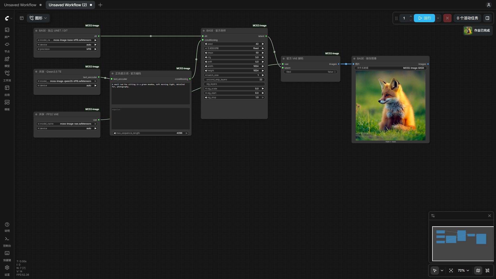
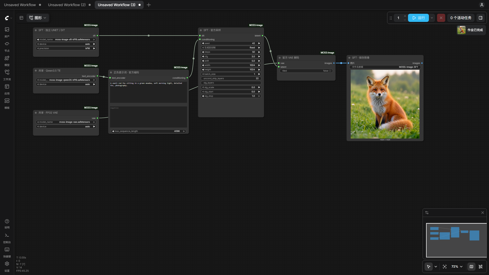

# 画布直接运行验收

v0.1.5 更新：[第四批 20 轮审查](review-20-rounds-4.md)修复共享 VAE 来源的并发导出冲突；Windows 77 项通过、3 项权限跳过，Linux CPU 子集 28 项无跳过通过，Node.js 4 项通过。本批未重复历史全尺寸画布验收。

v0.1.4 更新：[第三批 20 轮审查](review-20-rounds-3.md)记录运行阶段文件绑定、软链接、取消及导出/并发准备修复。本机 76 项通过、3 项权限跳过；Linux CPU 子集 27 项无跳过通过。新服务 Base/SFT 各完成 256×256、4 步采样，SFT 与前版同参数图逐像素一致。

v0.1.3 更新：[第二批 20 轮审查](review-20-rounds-2.md)记录验证工具、下载取消及 Windows 启动器修复；55 项 Python、4 项 Node.js 测试通过，并完成新的 SFT 小图和缓存识别实测。

v0.1.2 更新：完成 [20 轮交叉审查与修复](review-20-rounds.md)，32 项测试通过；新服务 Base/SFT 完整 1024×1024、50 步回归均与原交付 PNG 逐像素一致。以下保留首次画布验收记录。

验证日期：2026-10-16。Windows / RTX 5090 Laptop 24 GB / ComfyUI 0.41.0 / 前端 1.55.17。

以下结果来自真实浏览器中的“运行”按钮：导入交付的原始工作流，点击运行，截取前端实际 POST 请求，再读取该 prompt_id 的服务端成功回执。两套任务均实际执行采样，非采样缓存命中。

| 工作流 | 分辨率 | 步数 | CFG / shift | seed / 负分支跳层 | 结果 | 服务端执行时间 |
|---|---|---:|---|---|---|---:|
| BASE | 1024×1024 | 50 | 3 / 5 | 42 固定 / 22 | 成功，画布显示 1024 预览 | 119.26 s |
| SFT | 1024×1024 | 50 | 3 / 5 | 42 固定 / 22 | 成功，画布显示 1024 预览 | 110.29 s |

时间包含当次加载与解码；缓存状态和后台负载不同，不作为两模型速度对比。两张实际生成图均已目视检查，内容为提示词中的红狐和草地，尺寸、颜色与非恒定像素检查通过。

## 可直接导入画布

- [SFT JSON](../example_workflows/moss-image-sft.json) / [SFT PNG（内含工作流）](../example_workflows/moss-image-sft.png)
- [Base JSON](../example_workflows/moss-image-base.json) / [Base PNG（内含工作流）](../example_workflows/moss-image-base.png)

上述四个文件都已分别通过前端文件选择器和画布拖放事件导入，共 8 个用例。每次导入前清空画布，确认实际新加载了 7 个节点、全部连线和全部控件参数；无节点验证错误。PNG 内的 prompt 与 workflow 元数据也逐项核对通过。

## 参数来源核对

| 参数 | 交付值 | 依据 |
|---|---|---|
| 宽 / 高 | 1024 / 1024 | 固定版本官方 MOSSImagePipeline.__call__ 默认值 |
| Steps / CFG | 50 / 3 | 官方 num_inference_steps / guidance_scale |
| Shift | 5 | 官方 MOSSImageScheduler 默认值 |
| 负分支跳层 | 22（从 0 开始） | 官方 uncond_skip_layers；模型深度 42，索引有效 |
| Batch / 最大文本长度 | 1 / 4096 | 官方 num_images_per_prompt / max_sequence_length |
| 负面 / 额外 SLG | 空 / 关闭 | 官方默认值；空 SLG 列表与 None 均关闭 |
| 随机种子 | 42，fixed | 官方示例种子；实际运行后未递增 |
| 精度 | TE、DiT BF16；VAE FP32 | 官方推荐；噪声、CFG、Euler 更新沿用官方 FP32 实现 |
| VAE tiling | 关闭 | 保持官方普通解码路径 |

参数依据由固定官方源码 AST 提取，再核对本节点运行时参数转发、浏览器实际请求、服务端收到的请求和 PNG 元数据。Base/SFT 两个官方仓库的 pipeline Git blob 已再次核对一致，未修改的官方文件 SHA256：

`1dac1aca9feb1bfdfc727a401e4b67d61a505d3190706d1b7d2d784f88678b31`

SFT 画布出图与此前相同参数的 API 出图对比：像素完全一致 = True，最大 RGB 差 = 0。

## 独立文件完整性

四个独立权重已重新计算完整 SHA256，并与官方原始分片逐 tensor 比对：1,936 个 tensor、37,364,118,004 个数据字节，shape、dtype 和原始字节全部一致。未将 DiT、TE、VAE 合成一个 checkpoint。

| 文件 | tensor 数 | 原始数据字节一致 | SHA256 前 12 位 |
|---|---:|---|---|
| diffusion_models/moss-image-base-bf16.safetensors | 463 | 是 | `dc5f8ef21e31` |
| diffusion_models/moss-image-sft-bf16.safetensors | 463 | 是 | `93d4ccbcd91c` |
| text_encoders/moss-image-qwen35-bf16.safetensors | 759 | 是 | `1cb2c3fb5a2c` |
| vae/moss-image-vae.safetensors | 251 | 是 | `56e130263bb9` |

完整 TE（含视觉权重）保留；两仓库共享 TE、VAE 和 tokenizer 的官方内容 ID 一致。配置与 tokenizer 同时对照官方 Git/LFS 内容 ID。每个权重各有独立 `.assets/manifest.json`。

## 测试与证据

15 项测试本轮重新通过，包括真实微型 Qwen3.5/DiT/VAE 与官方整管道逐像素一致、CFG/SLG、seed/batch、BN/unpack、流式导出和中断恢复。完整 TE 另有 CPU BF16 测试，实际画布运行使用 TE/DiT CUDA BF16 与 VAE CUDA FP32。

- [机器可读完整记录](validation.json)
- [官方参数与全部原始 tensor 审计](parameter-audit.json)
- [画布运行与 PNG 检查](canvas-validation.json)
- [真实文件导入检查](canvas-import.json)
- 原始浏览器请求、服务端回执、运行中截图：本地 `artifacts/canvas-base/`、`artifacts/canvas-sft/`。

## 实际画布与出图

Base：

SFT：

原生 KSampler 路径未作为本次验收对象；以上均为固定官方 Diffusers 管道。
